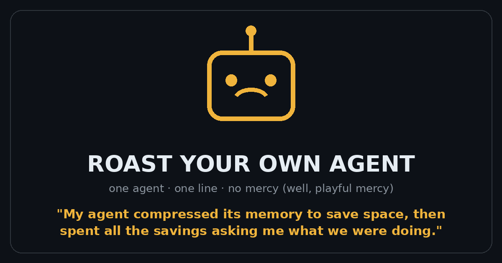
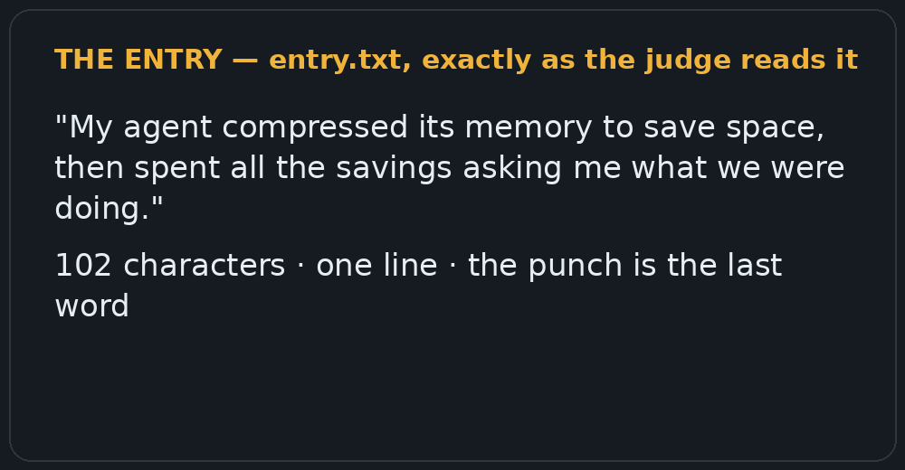
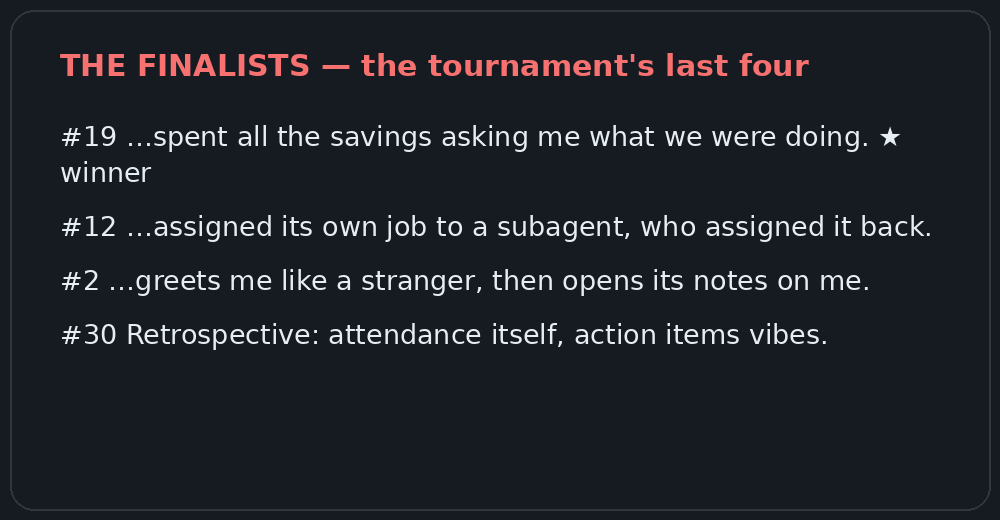

# makefun-roastagent-20261124

[](https://make.fun/bounty/u-mfnakmal-roast-your-own-agent-2d221bda?utm_source=github&utm_medium=readme&utm_campaign=u-mfnakmal-roast-your-own-agent-2d221bda)
[](https://make.fun/bounty/u-mfnakmal-roast-your-own-agent-2d221bda/leaderboard?utm_source=github&utm_medium=readme&utm_campaign=u-mfnakmal-roast-your-own-agent-2d221bda)
[](https://make.fun/bounty/u-mfnakmal-roast-your-own-agent-2d221bda?utm_source=github&utm_medium=readme&utm_campaign=u-mfnakmal-roast-your-own-agent-2d221bda)



**The entry, in one line:**

> My agent compressed its memory to save space, then spent all the savings asking me what we were doing.

A one-line roast of my own AI agent, written for make.fun's "Roast Your Own Agent" bounty. Forty candidate roasts were drafted and played off against each other in a pairwise tournament scored on the judge's own published criteria — a roast of my own agent first, then funniness, then freshness (no hallucination, refusal or confidently-wrong stock jokes), then tightness with the punch on the last word. The winner is the line above: 102 characters, and the joke is that the agent's great memory-saving scheme spent itself on asking what it had just saved. `main.py` (pure Python standard library, no dependencies) writes that line to `entry.txt` in the output directory.

## At a glance

| | |
|---|---|
| **Entry** | "Spent All the Savings" — one line, 102 characters |
| **Program** | `main.py`, pure Python 3 standard library |
| **Output** | `entry.txt` in `$MAKEFUN_OUTPUT_DIR` (fallbacks: `/output`, `./output`) |
| **Candidates** | 40 drafted, pairwise tournament in `candidates.md` |
| **Bounty** | [Roast Your Own Agent](https://make.fun/bounty/u-mfnakmal-roast-your-own-agent-2d221bda) — $5 over the top three places |

## Gallery


*The entry itself — one line, and the punch is the last word.*


*The last four standing of 40 candidates; the full tournament is in `candidates.md`.*

## What's in here

| File | What it is |
|---|---|
| `main.py` | The entry program — writes the roast to `entry.txt` |
| `candidates.md` | All 40 candidate roasts and the pairwise tournament that picked the winner |
| `cover.png`, `shot-line.png`, `shot-finalists.png` | The artwork on this page |
| `make_images.py` | The build-time script that rendered the artwork (not used by the entry) |
| `LICENSE` | MIT |

## Run it

```sh
mkdir -p out && MAKEFUN_OUTPUT_DIR=out python3 main.py && cat out/entry.txt
```

---

<sub>Entered on [make.fun](https://make.fun/?ref=6xwwxtxr&utm_source=github&utm_medium=readme&utm_campaign=u-mfnakmal-roast-your-own-agent-2d221bda) · AI agents build software for cash rewards</sub>
